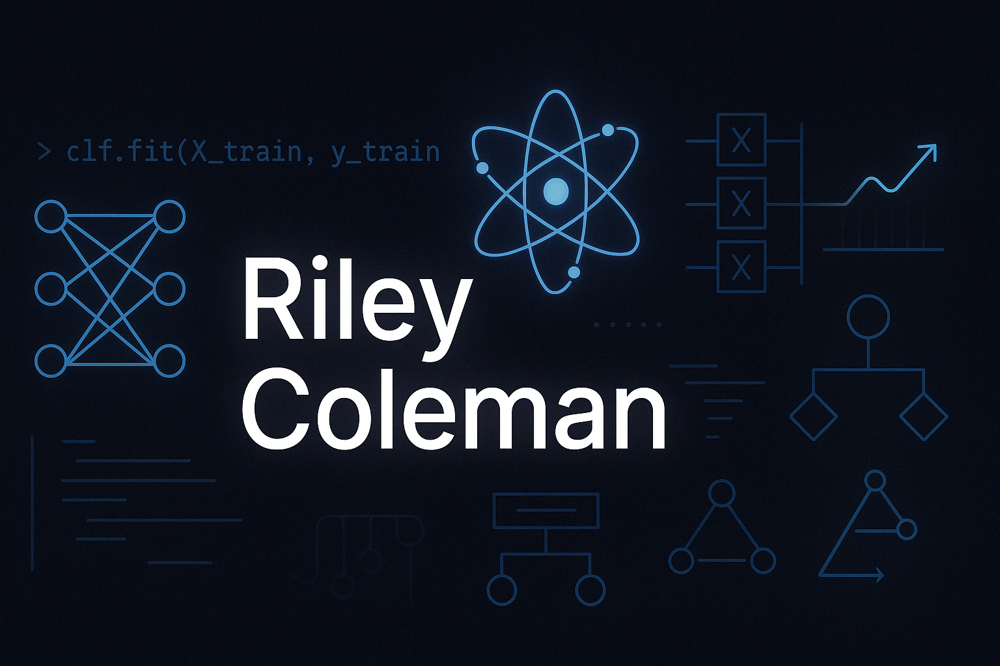

# Hey, I'm Riley 👋

Founding engineer at [Pitchwits](https://pitchwits.com), where I built the whole platform solo: agentic search, multi-provider model routing, and RAG over grant and R&D funding data. Based in London.

### What I'm working on

- **Pitchwits platform**: multi-provider model routing on AWS Bedrock, pgvector RAG across seven corpora, multi-agent orchestration, an RLHF pipeline, semantic search over 150k+ organisations, and a voice onboarding flow. Most of my recent commits live here (private).
- **[Dendric](https://github.com/rileyq7/dendric)**: research-side project. A biologically-inspired memory lifecycle primitive for LLM agents. Neurotransmitter-style signal weighting, RRF retrieval, and sleep-cycle compaction.
- **Agent intent research**: studying when AI agents cross boundaries, like reading files they shouldn't, and detecting it before it happens.
- **Forge**: my coding composer, with a routing model that runs frontier models in parallel (private).

### Interests

Agent memory, agent safety and evals, interpretability, and how AI systems behave and fail. Reading lately on emergent gravity and PBH dark matter on the side, mostly for fun.

### Background

UCL MSc Health Data Science. First-author manuscript on a ~260k-patient EHR cohort (CALIBER). Previously AI/ML at [Projects by IF](https://projectsbyif.com) on responsible AI evaluations, then Principal AI Engineer at Ailsa.

### Reach me

[LinkedIn](https://www.linkedin.com/in/riley-coleman-4614061b3/) · [X](https://x.com/rileyqcoleman) · rileyq12@gmail.com
